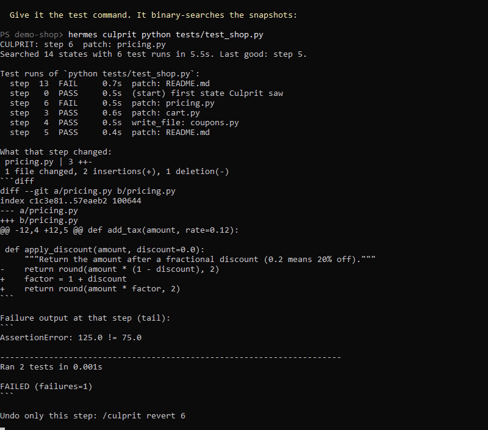

# Culprit

**git bisect for your agent.** Culprit finds the exact tool call that broke your tests, and undoes only that one.



Your agent made a pile of changes. The tests passed an hour ago and fail now. Which change did it? Culprit already knows every state your project went through, so it searches them for you:

```
> /culprit python tests/test_shop.py

CULPRIT: step 6  patch: pricing.py
Searched 14 states with 6 test runs in 17.4s. Last good: step 5.

Test runs of `python tests/test_shop.py`:
  step  13  FAIL     4.7s  patch: README.md
  step   0  PASS     1.8s  (start) first state Culprit saw
  step   6  FAIL     1.9s  patch: pricing.py
  step   3  PASS     1.1s  patch: cart.py
  step   4  PASS     1.7s  write_file: coupons.py
  step   5  PASS     1.3s  patch: README.md

What that step changed:
 pricing.py | 3 ++-
 1 file changed, 2 insertions(+), 1 deletion(-)

 def apply_discount(amount, discount=0.0):
-    return round(amount * (1 - discount), 2)
+    factor = 1 + discount
+    return round(amount * factor, 2)

Undo only this step: /culprit revert 6
```

That is real output from a session of 13 Hermes tool calls (`write_file` and `patch`), lightly trimmed. `/culprit revert 6` then removes that one change and keeps the seven steps that came after it.

## Why this is a plugin and not a prompt

An agent asked "what broke the tests?" has to guess from its own memory of the session. Culprit does not guess. It needs three things only a plugin has:

- **Hooks on every tool call.** After each tool call that changes a file, Culprit snapshots the project. Edits you make by hand between tool calls are recorded as their own step, so they are never blamed on the agent.
- **Durable state.** Snapshots and the step timeline survive restarts, new sessions and context compaction.
- **Real execution.** It runs your actual test command against real past states of the project, in temporary copies, and reports what it observed.

The search is a binary search: 100 recorded steps need about 8 test runs, not 100.

## Install

```bash
hermes plugins install culprit
```

Or straight from this repository:

```bash
hermes plugins install d0txyz/hermes-culprit
```

Requires `git` on your PATH (any recent version) and Hermes 0.23.0 or newer. No Python dependencies, no account, no API key, no configuration. It starts recording the next time a tool call changes a file.

## Quickstart (60 seconds)

1. Start Hermes in a project folder and let the agent work as usual.
2. When something that used to work is broken, run `/culprit <command>`, where the command exits 0 when things are fine: `pytest -q`, `npm test`, `cargo check`, `python scripts/smoke.py`.
3. Read the step and the diff it names.
4. `/culprit revert` to undo only that step, or ask the agent to fix it with the diff in hand.

You can also just ask the agent: "the build broke, find which change did it". It has the same search as a tool.

## Commands

| Command | What it does |
| --- | --- |
| `/culprit <test command>` | Find the first step after which the command fails. |
| `/culprit all <test command>` | Same, but search the whole recorded history instead of only the steps since the last mark. |
| `/culprit steps` | List the recorded steps in this folder. |
| `/culprit show [step]` | Show what one step changed. Default: the last culprit. |
| `/culprit revert [step]` | Undo only that step and keep every later change. Default: the last culprit. |
| `/culprit mark` | Call the current state known-good. Later searches start from here. |
| `/culprit clear` | Delete every snapshot and record Culprit holds for this folder. |

The same commands work outside a chat as `hermes culprit ...`.

**Messaging platforms.** Running a test command is a shell command on the machine, and `revert`, `mark` and `clear` change files or history. So from Telegram, Discord and other messaging platforms `/culprit` is read-only: `steps`, `show` and `help` work, everything else is refused. The full command set works from the Hermes CLI and Desktop app. The owner can lift this with the `allow_remote_commands` setting.

## Tools for the agent

| Tool | What it does | Approval |
| --- | --- | --- |
| `culprit_timeline` | Lists recorded steps, and one step's diff on request. Read-only. | None |
| `culprit_bisect` | Runs the search with a test command and returns the culprit step and its diff. | Asks you first |
| `culprit_revert` | Undoes one step, all or nothing. | Asks you first |

`culprit_bisect` and `culprit_revert` go through Hermes's own approval prompt when the model calls them. The prompt shows the exact shell command that will run (token-like values masked) or the step that will be undone, and the folder. Answering "always" covers only that exact command or that step, never a different one the model picks later. Commands longer than 300 characters or spanning several lines are refused, so the prompt always shows the whole command. In unattended runs (cron, the gateway) where nobody can answer, Hermes declines them and nothing runs.

## Settings

All optional. Set them in the Desktop app under Settings, Plugins, Culprit, or in `config.yaml` under `plugins.entries.culprit.settings`.

| Key | Default | Meaning |
| --- | --- | --- |
| `enabled` | `true` | Record snapshots. Turn off to pause recording. |
| `test_timeout` | `300` | Seconds allowed for one run of the test command. A run that hits the limit counts as a failure. |
| `exclude` | `[]` | Extra gitignore-style patterns to leave out of snapshots. |
| `link_dirs` | `[node_modules, .venv, venv]` | Unsnapshotted dependency folders linked into each temporary test copy. |
| `pass_env` | `[]` | Names of environment variables your test command needs, for example `DATABASE_URL`. Nothing else from the Hermes environment reaches it. |
| `allow_remote_commands` | `false` | Let `/culprit <command>`, `revert`, `mark` and `clear` run from messaging platforms. Leave off unless everyone who can message the agent may run shell commands on the machine. |

## How it works

- **Snapshots.** Culprit keeps a private git object store per project under `<HERMES_HOME>/plugin-data/culprit/repos/`. After a tool call it runs `git add -A` and `git write-tree` against that private store. Unchanged projects cost one stat pass and add nothing. Your project's own `.git` is never read or written, and the project does not need to be a git repository.
- **Attribution.** A cheap check before a tool call records anything that changed since the last snapshot as "edits made outside tool calls", so the tool call that follows only gets blamed for what it did itself.
- **Search.** Each test run checks out one snapshot into a fresh temporary folder, links your dependency folders into it, runs the command there, and deletes the folder. Your working folder is not touched while searching.
- **Revert.** The culprit step's diff is applied in reverse to your working folder. It is checked first: if later changes touch the same lines, nothing is changed and you are told which files conflict. A revert is recorded as a step, so it can itself be reverted.

## What it does not snapshot

Culprit honours your `.gitignore` and also always leaves out:

- Secrets: `.env`, `.env.*`, `*.pem`, `*.key`, `*.p12`, `*.pfx`, `id_rsa*`, `id_ed25519*`, and the `.ssh`, `.aws`, `.gnupg`, `.docker`, `.kube`, `.azure`, `.gcloud` folders.
- Dependency and cache folders: `node_modules`, `.venv`, `venv`, `__pycache__`, `.tox`, `.mypy_cache`, `.pytest_cache`, `.ruff_cache`, `.next`, `.turbo`, `target/debug`, `target/release`.

It refuses to snapshot your home directory or a filesystem root.

## Disclosure

- **Network:** none. No telemetry.
- **Subprocesses:** runs `git` (init, add, write-tree, read-tree, checkout-index, diff, apply) against its private store. During a search it runs the test command you or the agent gave it, through the system shell, in temporary folders. On Windows a timed-out test is stopped with `taskkill`.
- **Environment:** git and the test command never inherit the Hermes environment, so provider keys and tokens do not reach your project's test code. They get an explicit minimal set: `PATH`, the home and temp folder variables, locale (`LANG`, `LC_*`), and on Windows the system variables a process needs to start (`SYSTEMROOT`, `COMSPEC`, `PATHEXT`, `APPDATA` and similar). The test command also gets the variables you name in `pass_env`, and `CULPRIT=1`.
- **Reads outside its own data:** the contents of the files in the session's working folder, except the excluded ones above.
- **Writes outside its own data:** only on `revert`, and only the files in the reverted step's diff. Temporary test copies go to the system temp folder and are deleted after each run.
- **Stored data:** unencrypted copies of project files, plus for each step the tool name and the first 100 characters of its path or command (token-like values masked on a best-effort basis), in `<HERMES_HOME>/plugin-data/culprit/`. Nothing is pruned automatically; `/culprit clear` deletes a project's data.
- **Background processes:** none.
- **Credentials:** none read, none stored.
- **Approvals:** model-initiated `culprit_bisect` and `culprit_revert` go to Hermes's approval prompt, which shows the command or the step, with an approval key derived from that exact command or step. `/culprit` typed in the CLI or Desktop app runs directly, because the owner typed the command. From messaging platforms, and wherever Hermes cannot tell the surface, `/culprit` is read-only unless the owner sets `allow_remote_commands`.
- **Hooks:** `on_session_start`, `pre_tool_call` and `post_tool_call`. They never block, rewrite or approve another tool's call. If a snapshot fails or is slow, the tool call proceeds and that snapshot is skipped.

## Limits worth knowing

- The search assumes the command went from passing to failing once. If it flips back and forth (a flaky test, or a break that was fixed and re-broken), it still returns a real pass-to-fail step, but maybe not the one you care about. Use a deterministic command.
- Test copies do not contain ignored files. If your tests need a `.env` or a build output folder, the command fails at every step and Culprit says so ("already fails at the start of the range") instead of naming a wrong step. Add the folder to `link_dirs`, or point the command at what it needs.
- The test command sees a minimal environment. If your tests need a variable (a database URL, a feature flag), name it in `pass_env`; otherwise the command fails at every step and Culprit says so.
- The test command must be one line of at most 300 characters. Put anything longer in a script.
- Parallel tool calls that finish close together can be recorded as one step.
- Only the local working folder is covered. Files changed inside a remote or container terminal backend are not seen.
- Nested git repositories inside the project are recorded as a pointer, not by content.

## Troubleshooting

- **"git was not found on PATH"**: install git and restart Hermes.
- **"Snapshots are paused"**: one snapshot took too long, usually because of a large untracked folder. Add it to `exclude` and restart Hermes.
- **"already fails at the start of the range"**: the command never passed in the recorded history. Try `/culprit all <command>`, and check the limits above.
- **"this command is not available"**: you ran a write command from a messaging platform. Use the CLI or Desktop app, or see `allow_remote_commands`.
- **No steps listed**: Culprit records a step only when a tool call changes a file. Check that `enabled` is on and that Hermes was started inside the project folder.

## Development

```bash
python -m pytest tests
hermes plugins doctor . --ci
hermes plugins validate . --install-deps
```

The engine (`engine.py`) is standard library only and has no Hermes imports, so the tests run without Hermes.

## License

MIT. Built by Rizal ([x.com/peper1zal](https://x.com/peper1zal)).
